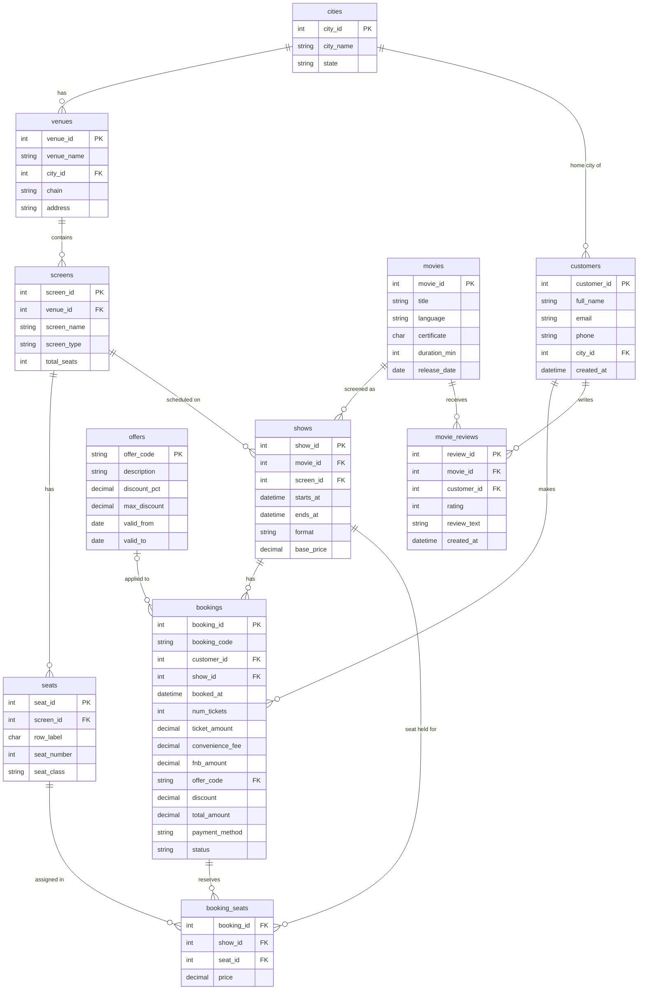

# ER Diagram — BookMyShow Ticketing System

> **Note:** This file contains a [Mermaid](https://mermaid.js.org/) `erDiagram` block.  
> Render it with any Mermaid-compatible viewer (e.g., the Mermaid Live Editor at https://mermaid.live, GitHub Markdown preview, VS Code Mermaid extension, or `mmdc` CLI to export to PNG).  
> To generate the PNG: `mmdc -i diagrams/er_diagram.md -o diagrams/er_diagram.png`

---

## Relationship Notes

| Relationship | Cardinality | Notes |
|---|---|---|
| `cities` → `venues` | 1 : Many | A city has zero or more venues; each venue belongs to exactly one city |
| `venues` → `screens` | 1 : Many | A venue contains one or more screens (auditoriums) |
| `screens` → `seats` | 1 : Many | A screen has many physical seats |
| `screens` → `shows` | 1 : Many | A screen hosts many shows over time (non-overlapping, enforced by exclusion constraint) |
| `movies` → `shows` | 1 : Many | A movie appears in many scheduled shows |
| `cities` → `customers` | 1 : Many | A customer's home city; a city has many registered customers |
| `customers` → `bookings` | 1 : Many | A customer makes many bookings over time |
| `shows` → `bookings` | 1 : Many | A show receives many bookings (from different customers) |
| `offers` → `bookings` | 0..1 : Many | An offer is optionally applied to a booking; a booking has at most one offer (nullable FK) |
| `bookings` → `booking_seats` | 1 : Many | A booking reserves one or more seats |
| `shows` → `booking_seats` | 1 : Many | A show has many seat assignment records across all bookings |
| `seats` → `booking_seats` | 1 : Many | A seat can be booked in many shows over time (but only once per show — enforced by PK) |
| `movies` → `movie_reviews` | 1 : Many | A movie receives many audience reviews |
| `customers` → `movie_reviews` | 1 : Many | A customer can write multiple reviews (for different movies or repeat viewings) |
